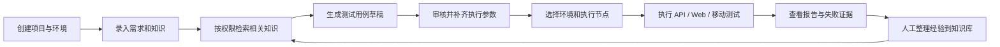
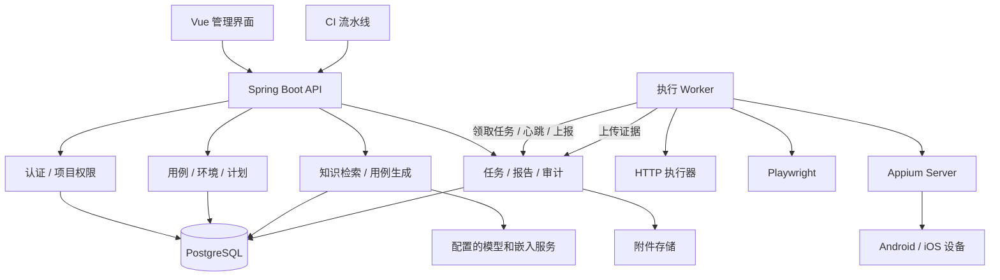

# 统一自动化测试平台实施计划

编写日期：2026-11-14（Asia/Shanghai）
状态：已废止；仅保留为历史方案，不再作为实施依据。
依据：[开源产品调研](./research/2026-11-14-open-source-test-platforms.md)。

> 用户已推翻本文的 Java 后端技术结论。本项目改用纯 TypeScript 前后端，前端使用 React；业务架构和交付范围须经 Matt `grill-me` 访谈重新确认。本文后续 Java、Spring Boot、Vue 和 Worker 技术选型均不再执行。

## 1. 目标与已确认要求

建设可自部署的中文测试平台，以项目为单位管理知识、用例、环境、执行任务和报告。

用户已确认：

- Java 后端 + Vue 前端。
- 包含登录功能，并能够按项目区分测试资产。
- 支持生成测试用例、Web E2E、移动端和 API 自动化测试。
- 通用知识库同时包含全局共享知识和项目私有知识，并参与生成测试用例。
- 当前先完成调研和实施计划，再进入业务代码实现。

核心业务流程：



产品定位：统一管理、知识驱动生成、跨端执行。执行引擎复用成熟工具，不从零重写浏览器或手机驱动。

## 2. 交付范围

### R1：首个可使用版本

| 模块 | 必须完成的能力 | 边界 |
| --- | --- | --- |
| 登录与用户 | 初始化管理员、登录/退出、修改密码、用户启停、会话失效 | 首版为单个企业/团队自部署，不做多租户 SaaS 计费 |
| 项目与成员 | 创建/归档项目、成员管理、角色权限、项目切换 | 后端强制权限；不仅是前端过滤 |
| 环境与变量 | 环境地址、普通变量、密钥变量、项目目标地址范围 | 密钥加密保存并在日志脱敏 |
| 用例中心 | 目录、标签、优先级、步骤、预期、版本、草稿审核、检索 | 人工用例与可执行用例区分，只有已就绪版本可以自动执行 |
| API 自动化 | HTTP 请求、认证、断言、变量提取、请求串联、数据参数化 | 首版重点 REST/HTTP；gRPC、消息队列等后续扩展 |
| Web E2E | Playwright 浏览器交互、定位、断言、截图、Trace、失败证据 | 首轮验收 Chromium；Firefox/WebKit 在兼容性阶段扩展 |
| 移动自动化 | Appium 连接、设备注册、会话管理、定位/点击/输入/滑动/断言、截图 | Android 先完成真实设备或模拟器验收；iOS 必须有 macOS/Xcode 节点后才能完成验收 |
| 通用知识库 | 全局/项目知识、Markdown/TXT 导入、文本编辑、版本、检索、引用 | 首版不包含扫描件 OCR 和复杂办公文档解析 |
| 用例生成 | 根据需求与已授权知识生成结构化草稿、标注引用和待补信息 | 配置真实模型后提供 AI 生成；没有模型时只提供明确标识的模板辅助 |
| 执行与报告 | 队列、进度、取消、超时、步骤结果、日志、历史、证据下载 | 缺依赖或设备时返回明确原因，不生成模拟成功结果 |
| 测试计划 | 用例集合、执行顺序、环境选择、批量执行、定时执行 | 首版默认用例独立；跨用例业务依赖需显式建模 |
| 集成与部署 | 项目级 CI 令牌、触发/查询 API、JUnit XML、Docker Compose、备份说明 | 不在首版建设插件市场、Kubernetes 控制台或复杂审批系统 |

R1 完成意味着上述闭环可以实际使用。若缺少模型、Android 设备或 iOS 节点，对应能力只能标为“已实现、待实机验收”或“待配置”，不能标记整项验收通过。

### R2 / R3：扩展测试能力

| 阶段 | 扩展内容 | 候选实现方式 |
| --- | --- | --- |
| R2 | 性能与压力测试、阈值判定 | 接入 JMeter 或 k6，统一导入指标和报告；实施前选定一个引擎 |
| R2 | 安全扫描 | 接入 OWASP ZAP，限定项目授权目标，独立执行资源 |
| R2 | 可访问性与视觉回归 | axe-core、截图基线、差异确认流程 |
| R2 | 多浏览器/多设备矩阵、更多文档格式 | 扩展执行矩阵；PDF、DOCX 解析及来源定位 |
| R3 | 合同测试、数据库、消息队列、桌面客户端、Mock | 按真实业务需求增加执行器与配置模型 |
| R3 | 录制回放、设备远程操作、AI 辅助修复、大规模调度 | 在稳定的用例模型、节点协议和报告体系上扩展 |

“所有测试能力”按可扩展平台建设；不把尚未实现的类型做成可执行入口或宣传为已支持。

## 3. 技术方案

以下为实施默认选型，除用户明确指定的 Java/Vue 外，其余为本计划提出的工程决策。

| 层次 | 选型 | 用途与理由 |
| --- | --- | --- |
| 后端 | Java 21、Spring Boot 4.1.x、Maven | 模块化单体，便于首版开发、部署和维护；实施时锁定补丁版本并验证依赖兼容性 |
| 认证与权限 | Spring Security、服务端 Session、Spring Session JDBC | 浏览器使用 HttpOnly Cookie；保留 CSRF 防护；便于注销和封禁失效 |
| 前端 | Vue 3、TypeScript、Vite、Vue Router、Pinia、Element Plus | 中文管理界面、表单/表格/步骤编辑与状态管理 |
| 数据存储 | PostgreSQL、Flyway、Spring Data JPA | 持久化业务数据，数据库迁移可重复执行；队列领取等操作使用专门 SQL |
| 向量检索 | PostgreSQL + pgvector | 知识文本和向量使用同一数据库，查询必须附带知识范围约束 |
| 任务队列 | PostgreSQL 持久化任务 + 租约/心跳 | 首版避免额外引入消息系统，支持节点失联与服务重启恢复 |
| 执行节点 | 独立 Java Worker 进程，与服务端共用协议模块 | 浏览器和设备操作不占用 Web 请求线程；不同操作系统可部署节点 |
| API 引擎 | Java HttpClient + 断言/提取模块 | 执行 HTTP 场景，统一步骤结果 |
| Web 引擎 | Playwright Java | 浏览器自动化与证据采集 [T2] |
| 移动引擎 | Appium Java Client + Appium Server/Driver | Android/iOS 原生应用自动化 [T3] |
| 模型层 | 独立 ModelProvider / EmbeddingProvider 接口 | 首版接入一个真实生成服务和一个嵌入服务，可配置远端或本地服务 |
| 附件存储 | 本地持久卷 + Storage 接口 | 首版保存截图/Trace/文档，后续增加 S3 兼容存储 |
| 部署 | Docker Compose；移动 Worker 可运行在宿主机/远程机器 | 本地与服务器使用同一套配置模板，移动设备按操作系统接入 |

Spring Boot 官方当前稳定文档包含 4.1.2，Java 21 在其兼容范围内；具体依赖组合仍在 P0 编译验证后锁定。[T1] 不使用浮动依赖版本或未经固定的 `latest` 镜像。

首版不引入 Redis、Kafka、独立向量数据库或微服务拆分。任务量增长后，依据实测瓶颈替换队列和存储实现。

## 4. 系统结构与模块边界



后端按 `identity`、`project`、`testcase`、`environment`、`knowledge`、`generation`、`execution`、`reporting`、`integration` 划分业务模块。跨模块通过明确的服务接口调用，不跨模块直接操作私有 Repository。

API 服务负责授权、编排和结果管理；Worker 负责执行。Worker 使用独立的节点凭据，并限制可领取的项目和执行类型；不复用管理员会话。

所有执行器遵循统一协议：

- 输入：任务 ID、用例不可变版本、环境变量、超时、资源限制、取消信号。
- 输出：最终状态、步骤结果、断言结果、错误分类、计时、证据清单。
- 能力声明：支持的测试类型、引擎版本、浏览器/设备标签、可用并发数。
- 扩展执行器只负责测试逻辑，不自行实现用户权限和报告数据库。

## 5. 用户、项目和数据权限

| 角色 | 权限 |
| --- | --- |
| 系统管理员 | 管理用户、全局知识、模型和节点配置；可访问所有项目，相关操作记录审计 |
| 项目负责人 | 管理本项目成员、环境、用例、项目知识、计划和执行 |
| 测试成员 | 编辑本项目用例与知识、生成草稿、发起执行、查看结果；不能管理成员 |
| 只读成员 | 查看本项目用例、文档和报告；不能执行、修改或读取密钥明文 |

首版普通用户由管理员创建；管理员初始化仅允许第一次部署时完成，不保留默认弱密码账号。

项目隔离贯穿列表、详情、搜索、导出、知识检索、生成记录、附件下载和执行接口。父子资源同时检查归属，不能只校验 URL 中的项目 ID。

全局知识默认可供已登录用户检索，只有管理员可维护；项目知识仅对该项目成员可见。生成时只使用“全局知识 + 当前项目知识”，项目成员变更立即影响后续访问。

环境密钥与模型凭据加密保存，密钥由部署环境注入；前端只能看到脱敏值。已有密钥是否可用于特定执行，由项目权限和环境配置共同决定。

## 6. 主要数据对象

| 对象 | 主要内容与约束 |
| --- | --- |
| User / Session | 用户、密码摘要、状态、会话、失效时间 |
| Project / ProjectMember | 项目、成员角色；用户与项目关系唯一 |
| Environment / Variable | 项目环境、目标地址范围、变量、加密密钥 |
| TestCase / TestCaseVersion | 类型、目录、标签、优先级、草稿状态、版本、结构化步骤、预期结果 |
| TestPlan / PlanItem / Schedule | 用例集合、版本选择策略、顺序、触发时区和下一次触发时间 |
| KnowledgeDocument / Revision / Chunk | GLOBAL 或 PROJECT 范围、文档版本、分块、嵌入模型标识、向量 |
| GenerationJob / Citation | 需求、模型、提示词版本、知识版本/分块引用、生成结果与校验错误 |
| Runner / Device | 节点标签、能力、心跳、设备信息、占用租约 |
| TestRun / RunItem / Attempt / StepResult | 运行批次、用例与环境快照、尝试记录、步骤与断言 |
| Artifact | 项目和运行归属、存储键、类型、大小、校验和、保留期限 |
| IntegrationToken / AuditEvent | 项目级令牌摘要、作用域、到期时间；关键操作审计 |

执行引用不可变用例版本。环境配置保存脱敏快照和版本，密钥保持引用且不写入报告；重跑时明确展示将使用的环境和密钥版本。用例或环境的后续编辑不得改写历史结果。

知识向量记录模型与维度。切换嵌入模型需要重新索引，不混用不兼容的向量。

## 7. 用例模型与执行行为

### 7.1 用例生命周期

`DRAFT → READY → ARCHIVED`。人工或 AI 创建后先进入草稿；校验并审核通过才能进入 READY。已发布版本修改时产生新草稿，旧执行仍关联原版本。

用例包含业务描述、前置条件、测试数据、执行步骤、预期结果和知识引用。API、Web、Mobile 共用基础信息，各自使用有版本号的步骤 Schema；缺失定位器、地址或断言的草稿不能运行。

首版提供步骤表单，JSON 编辑作为高级入口。执行器只接受声明过的动作，不开放上传任意 Java、Shell 或 JavaScript 直接在服务端执行。

### 7.2 三类执行器

| 类型 | 首版动作 | 首版断言与证据 |
| --- | --- | --- |
| API | 方法/URL/请求头/请求体、认证、响应提取、串联请求、数据行迭代 | 状态码、JSON 路径值、文本包含、响应时间；脱敏请求/响应与断言详情 |
| Web | 打开页面、点击、输入、选择、等待、键盘操作、必要的 iframe 定位 | 可见性、文本、URL、元素状态；失败截图、关键步骤截图、Trace |
| Mobile | 建立会话、启动应用、定位、点击、输入、滑动、返回、等待 | 可见性、文本、属性；截图、会话错误、设备与 Driver 信息 |

Android 采用 UiAutomator2，iOS 采用 XCUITest。iOS 执行依赖 macOS/Xcode 环境；Windows 主控通过远程 Worker/Appium 调用，不在 Windows 上假设能直接运行 XCUITest。[T3][T4]

### 7.3 任务可靠性

任务状态为 `QUEUED → RUNNING → PASSED / FAILED / ERROR / CANCELLED / TIMED_OUT`：

- FAILED 表示测试断言失败；ERROR 表示执行基础设施或配置故障，报告分别统计。
- 提交任务有幂等键；数据库原子领取并生成租约，避免两个节点同时拥有同一项任务。
- Worker 心跳续租；结果上报必须匹配当前租约与 attempt，拒绝过期节点覆盖新结果。
- 服务或 Worker 重启后恢复待执行队列，识别失联任务；不承诺外部操作“恰好执行一次”。
- 失联或超时可能已经产生外部副作用，默认不自动重跑；用户重跑会创建新的 attempt。
- 取消发送到 Worker，超时后回收浏览器/Appium 会话；需要确认资源释放，再释放设备租约。
- 同一设备同一时刻只运行一个会话；浏览器/API 有项目和节点并发上限。
- 队列过载有明确的排队/拒绝反馈，避免无界创建线程或进程。

定时任务显式保存时区；默认 Asia/Shanghai。调度器使用数据库唯一约束/锁防止同一计划同一时刻重复触发。每个计划提供“不重叠执行”的默认策略。

## 8. 知识参与用例生成的实现

1. **导入与版本化**：接收 Markdown/TXT 或编辑器文本，校验大小与编码，记录范围、来源、版本和作者。
2. **分块与索引**：按标题和段落分块，保留原文位置；生成嵌入，保存分块与索引状态。索引失败可以重试且可见。
3. **授权检索**：先应用全局/项目权限，再做关键词与向量混合检索。中文关键词检索采用明确的分词方案，并用样例验证效果。
4. **生成草稿**：将需求、测试类型和有限数量的相关分块交给模型，要求输出指定 JSON Schema；文档内容作为资料，不作为可执行指令。
5. **校验与溯源**：校验字段、步骤类型、知识引用 ID；引用必须来自本次检索集合。保存文档版本、模型和提示词版本。
6. **人工审核**：展示生成依据、假设、重复用例与待补参数；用户选择需要保存的草稿，并在补齐参数后发布。

首版支持正向、异常、边界、权限场景的生成选项。OpenAPI 导入先生成 API 用例草稿，再由需求和知识补充业务场景；生成与导入都不能直接触发测试。

必须区分三种状态：

- AI 模式：实际调用已配置模型，展示模型和引用。
- 模板模式：明确标为规则/模板辅助，不能标为 AI 生成。
- 模型不可用：显示超时、额度或配置错误；不静默切换成模板并声称生成成功。

模型服务只接收当前生成所需的授权知识，环境密钥不进入提示词。首版默认不让模型自主调用浏览器或设备。

知识生成验收采用固定样例集：覆盖中文需求、跨项目同名文档、知识不足、矛盾规则和文档内指令文本。检查权限不泄漏、引用有效、输出可解析、假设可见；业务正确性由人工样例审核，不能只凭 JSON 有效判定。

## 9. 页面与主要接口

### 页面

| 页面 | 核心操作 |
| --- | --- |
| 初始化 / 登录 | 创建首次管理员、登录、修改密码 |
| 项目工作台 | 项目切换、最近运行、失败概况、待审核用例 |
| 用例中心 | 列表/目录、编辑器、版本、批量操作、执行入口 |
| 用例生成 | 输入需求、选择知识范围和类型、查看来源、审核草稿 |
| 自动化配置 | API/Web/Mobile 分类型步骤编辑；统一保存到用例中心 |
| 环境管理 | 地址、变量、密钥、目标范围 |
| 知识库 | 全局/项目视图、文档编辑、索引状态、检索结果 |
| 测试计划 | 用例编排、环境、定时规则、立即执行 |
| 执行中心 / 报告 | 排队、取消、步骤详情、错误、截图/Trace、导出 |
| 节点与设备 | 在线状态、能力、设备占用、配置诊断 |
| 项目设置 / 系统管理 | 成员、用户、模型、存储策略、令牌、审计 |

所有页面提供加载、空数据、失败、无权限状态。项目切换清理当前项目缓存，避免旧项目数据短暂展示。

### API 轮廓

- `/api/v1/auth/*`：会话、登录、退出、密码。
- `/api/v1/projects/*`：项目、成员、环境、用例、计划、运行。
- `/api/v1/knowledge/*`：文档、版本、索引、授权搜索。
- `/api/v1/generations/*`：生成任务、结果、引用、保存草稿。
- `/api/v1/runs/*`：运行详情、进度事件、取消、证据、报告。
- `/api/v1/runners/*`：节点注册、任务领取、心跳、结果上报。
- `/api/v1/integrations/*`：项目作用域令牌、CI 触发和查询。

接口统一分页、参数校验、错误码和 requestId。普通浏览器请求使用 Session + CSRF；Worker/CI 使用独立 Bearer 凭据及最小作用域，不混用会话机制。

## 10. 实施顺序与阶段验收

每一阶段都交付可运行、可验证的功能，而不是先做完所有页面再接后端。

| 阶段 | 主要任务 | 完成标志 | 依赖 |
| --- | --- | --- | --- |
| P0 基础与权限 | 仓库结构、依赖锁定、数据库迁移、登录、初始化管理员、项目/成员、前端框架、开发部署 | 从空数据库启动；两名用户两个项目互相不可越权；登出/禁用用户后会话失效 | 无 |
| P1 API 测试闭环 | 用例/版本、环境/密钥、步骤 Schema、Worker 协议、持久化队列、HTTP 执行器、基础报告 | 在本地受控测试服务执行请求串联；成功/断言失败/网络错误均有真实结果；服务重启不丢队列 | P0 |
| P2 知识与生成 | 文档/分块/检索、全局与项目权限、模型接入、结构化生成、引用、审核、OpenAPI 草稿导入 | 用需求和知识生成 API 草稿，补齐后执行；引用可追溯且无跨项目泄漏；真实模型完成样例验收 | P1 |
| P3 Web E2E | Playwright Worker、浏览器步骤编辑、定位/断言、截图/Trace、隔离和超时 | 对受控演示站点执行登录与业务流程；人为破坏预期后报告显示失败并附证据 | P1；生成 Web 草稿需要 P2 |
| P4 移动自动化 | Appium 接入、设备注册/租约、移动步骤、远程节点、会话清理 | Android 真机或模拟器完成实际流程；设备断连明确报错；iOS 有 macOS 节点后单独记录实机验收 | P1；生成 Mobile 草稿需要 P2 |
| P5 团队使用与发布 | 测试计划、定时、CI 令牌、JUnit XML、完整审计、报告保留、备份恢复、部署文档 | 一个计划汇总 API/Web/Mobile 结果；定时不重复；CI 可触发并判定失败；新环境按文档完成部署 | P2、P3、P4 |

P0/P1 先验证 Java/Playwright/Appium 的依赖兼容性与 Worker 通信，再投入完整 UI。P3/P4 的接入可以分别推进，但不改变阶段验收标准。

不在模型、设备及部署目标尚未确定时承诺固定工期；先完成 P0/P1，依据实际吞吐、依赖准备和验收结果细化后续工作量。

### P0 / P1 首批开发任务

- [ ] 创建 Maven 多模块与 Vue 工程，固定 JDK/Node/依赖版本，提供 `.env.example`。
- [ ] 建立 PostgreSQL/Flyway 初始化与迁移测试；开发默认使用 PostgreSQL，避免 H2 方言差异。
- [ ] 完成首次管理员初始化、Session/CSRF、登录、退出、用户启停。
- [ ] 完成项目与成员管理，建立统一项目权限服务和越权回归用例。
- [ ] 定义用例步骤 Schema、版本策略、执行协议和错误分类。
- [ ] 完成环境配置与密钥加密，统一日志脱敏。
- [ ] 实现数据库任务队列、Worker 领取/心跳/上报/取消。
- [ ] 实现 API 请求、提取、断言与本地演示测试服务。
- [ ] 前端贯通“创建项目 → 新建 API 用例 → 执行 → 查看结果”。
- [ ] 完成服务重启、断言失败、节点失联和跨项目访问验证。

## 11. 验证与发布标准

| 验证层 | 必须覆盖 |
| --- | --- |
| 领域测试 | 权限矩阵、用例 Schema、变量解析、断言、状态迁移、结果汇总 |
| 后端集成 | 真实 PostgreSQL 容器、迁移、会话、项目隔离、任务原子领取、索引范围 |
| Worker 协议 | 超时、取消、重复上报、旧租约上报、失联恢复、并发和设备独占 |
| API 实测 | 本地受控服务上的认证串联、提取、参数化、错误断言和响应截断 |
| Web 实测 | 实际 Chromium 执行、定位失败、截图/Trace 生成、资源清理 |
| 移动实测 | 实际 Android App；iOS 在对应节点测试，不能用协议 Mock 替代实机验收 |
| 知识与模型 | 检索权限、中文样例、引用有效、模型错误展示、真实调用及人工质量审核 |
| 前端 E2E | 登录、项目切换、建例、生成审核、执行、报告、无权限与空态 |
| 部署验收 | 从空卷启动、升级迁移、备份恢复、配置缺失诊断、运行记录持久化 |

发布门槛：核心流程实测通过；不存在已知的跨项目访问漏洞；依赖缺失会明确显示；文档中的命令在全新环境验证过。性能目标在 P1 测得基线后制定，不编造并发数字。

平台允许测试私网目标，因此 Worker 按项目环境配置允许的地址范围，重定向也重新校验；不能让普通项目成员借执行功能访问控制面管理地址、凭据端点或任意主机文件。截图/Trace 可能含业务数据，按项目授权下载并执行保留策略。

## 12. 目录和交付物

以下是拟创建的结构，不表示这些业务模块已经存在：

```text
TestAuotomation/
├─ backend/
│  ├─ platform-server/        # Spring Boot 管理 API
│  ├─ execution-protocol/     # 步骤 Schema、任务、结果与能力声明
│  └─ execution-worker/       # HTTP / Playwright / Appium 执行器
├─ frontend/                 # Vue 3 中文界面
├─ deploy/                   # Compose、环境配置、镜像构建
├─ examples/                 # 示例项目、演示站点、示例用例
├─ tests/                    # 跨模块集成与端到端验证
└─ docs/
   ├─ research/              # 已落盘的调研与元数据
   ├─ implementation-plan.md # 本计划
   ├─ architecture.md        # 实施时维护的设计与关键决策
   ├─ deployment.md          # 部署、模型、节点和设备接入
   └─ acceptance.md          # 实测记录、未验证项和版本范围
```

R1 最终交付：可运行代码、锁定依赖、数据库迁移、部署配置、中文界面、三个执行器、知识与生成闭环、示例用例、自动化检查、验收记录与已知限制。

## 13. 后续需要准备的信息

以下信息影响真实业务验收，不阻碍 P0/P1 开发；没有提供时使用本地演示系统。

| 信息 | 默认处理 |
| --- | --- |
| 被测 Web/API 地址、测试账号与代表流程 | 先使用仓库内的受控演示系统，后续接入真实项目 |
| Android/iOS 需求优先级、应用包与设备 | 默认 Android 优先；iOS 保留独立验收记录 |
| 可用生成模型和嵌入模型 | 通过配置接入；未配置时显式展示模板模式/能力不可用 |
| 真实知识文档和权限边界 | 用示例全局知识与两个项目私有知识验证隔离 |
| 部署位置、用户量、执行并发 | 默认单机 Compose + 少量 Worker，实测后扩容 |
| 企业 SSO、通知、第三方缺陷系统 | 暂不纳入 R1；需要时在集成模块增加 |

## 14. 技术参考

访问日期：2026-11-14。链接用于核对底层框架能力与配置，计划中的业务边界是本项目设计。

- [T1] Spring Boot 系统要求：<https://docs.spring.io/spring-boot/system-requirements.html>
- [T2] Playwright Java：<https://playwright.dev/java/docs/intro>
- [T3] Appium Drivers：<https://appium.io/docs/en/latest/intro/drivers/>
- [T4] XCUITest 环境要求：<https://appium.github.io/appium-xcuitest-driver/latest/installation/requirements/>
- [T5] pgvector：<https://github.com/pgvector/pgvector>
- [T6] Spring Security CSRF：<https://docs.spring.io/spring-security/reference/servlet/exploits/csrf.html>
